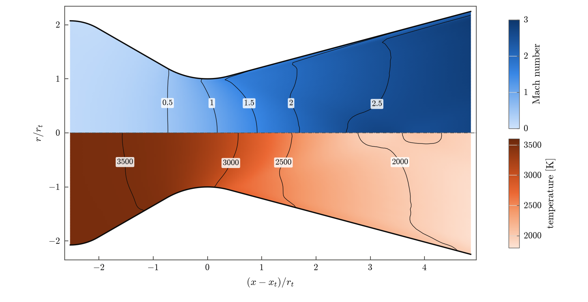
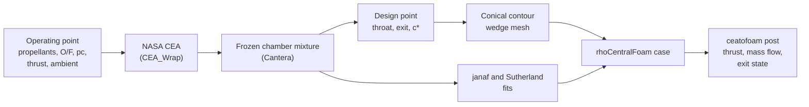
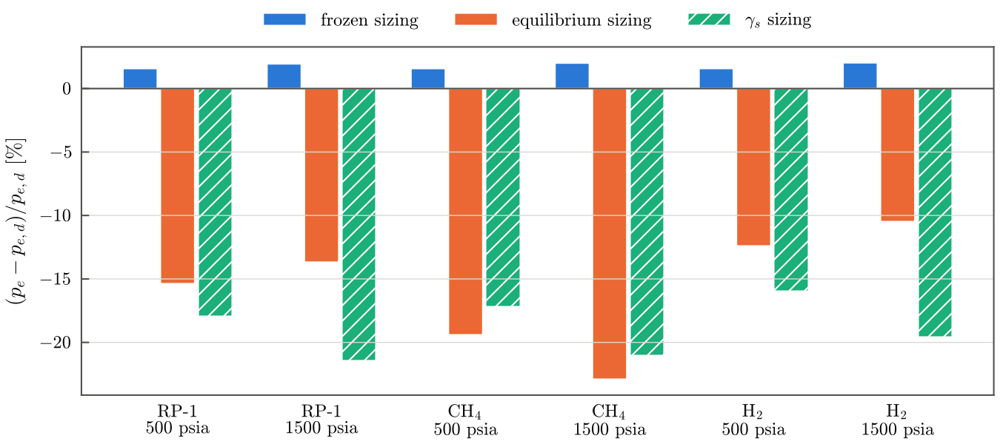

<div align="center">

# ceaToFoam

**From a NASA CEA chamber solution to a ready-to-run OpenFOAM thrust-chamber case**

[](https://mcf2-lab.github.io/ceaToFoam/)
[](https://doi.org/10.5281/zenodo.23637114)
[](LICENSE)
[](pyproject.toml)
[](https://www.openfoam.com)
[](CITATION.cff)



<sub>Mach number (upper half) and temperature (lower half) in an RP-1/LOX thrust chamber at 500 psia and O/F 2.4,
sized for 2250 lbf at sea level with the frozen mixture and computed with the k-ω SST model.</sub>

</div>

ceaToFoam takes the propellants, chamber pressure, mixture ratio and design
thrust of a liquid-rocket engine and writes an axisymmetric `rhoCentralFoam`
case for the flow through its conical thrust chamber. The chamber composition
computed by CEA is frozen and evaluated with one set of thermodynamic and
transport data, and this one description of the gas both sizes the nozzle and
defines the thermophysical model of the simulation. The design point and the
CFD therefore describe the same gas, so the difference between them is the
multidimensional and viscous loss of the thrust chamber, not an artefact of
the handoff.

**Documentation: <https://mcf2-lab.github.io/ceaToFoam/>**

## How it works



## Verified and validated

| Check | Result |
| --- | --- |
| Frozen sizing vs. CEA's frozen solution | exit temperature, Mach number and Isp within 0.1 % |
| Simulated vs. design exit pressure (frozen sizing, inviscid) | within 2.03 % for RP-1, CH₄ and H₂ with LOX at 500 and 1500 psia |
| Simulated vs. design mass flow rate (same cases) | within 0.54 % |
| Wall pressure in conical nozzles, Back et al. (1965) | RMS deviation of p/p<sub>t</sub> at most 0.018 |
| Discharge coefficient, Back and Cuffel (1971) | within the measurement uncertainty for 5 of 7 nozzles |
| Base mesh vs. finest mesh | thrust, mass flow, exit pressure and Isp within 0.27 % |

Sizing the same nozzles with CEA's equilibrium isentropic exponent instead
leaves the frozen-flow simulation 16 to 21 % below the design exit pressure,
while the mass flow rate stays within 0.7 % of the design value. Details are on
the [verification and validation](https://mcf2-lab.github.io/ceaToFoam/validation/)
page.

<p align="center">

</p>

## Quick start

```sh
git clone https://github.com/MCF2-Lab/ceaToFoam.git && cd ceaToFoam
pip install .                     # or: pip install '.[plot]'

ceatofoam design examples/rp1-lox-500psi.yaml            # print the design point
ceatofoam case   examples/rp1-lox-500psi.yaml cases/rp1  # write the case
cd cases/rp1 && ./Allrun                                 # blockMesh ... rhoCentralFoam
ceatofoam post   .                                       # thrust, mass flow -> results.json
```

Requirements: Python 3.9 or newer, an OpenFOAM.com release (tested with
v2606) and the CEA executable. CEA_Wrap ships the executable for Windows only;
on Linux and macOS compile it once:

```sh
ASSETS=$(python3 -c "import CEA_Wrap, os; print(os.path.join(os.path.dirname(CEA_Wrap.__file__), 'assets'))")
mkdir -p ~/.local/bin && cd "$ASSETS"
gfortran -O2 -std=legacy -o ~/.local/bin/Dan_CEA2 dan_cea2.f
export CEA_EXE_LOCATION=~/.local/bin/Dan_CEA2    # add to ~/.bashrc
```

## Commands

| Command | What it does |
| --- | --- |
| `ceatofoam design INPUT` | Print the CEA results, the frozen mixture and the design point |
| `ceatofoam case INPUT CASE_DIR` | Write the OpenFOAM case and its record `ceatofoam.json` |
| `ceatofoam post CASE_DIR` | Average the last quarter of the run and write `results.json` |
| `ceatofoam sweep --fuel F --oxidizer O --pressure P` | Run CEA over a range of O/F |
| `ceatofoam interactive CASE_DIR` | Ask for the inputs on the console, then write the case |

Every case records its input, the CEA results, the frozen mixture, the fit
errors, the design point, the contour, the mesh and the versions of every
component, including the source revision of ceaToFoam.

## Documentation

| Page | Contents |
| --- | --- |
| [Installation](https://mcf2-lab.github.io/ceaToFoam/installation/) | requirements, CEA on Linux and macOS, tests |
| [Usage](https://mcf2-lab.github.io/ceaToFoam/usage/) | a complete walkthrough, from the design point to `results.json` |
| [Input reference](https://mcf2-lab.github.io/ceaToFoam/input/) | every option of the YAML input |
| [The OpenFOAM case](https://mcf2-lab.github.io/ceaToFoam/case/) | domain, mesh, boundary conditions, thermophysics, function objects |
| [Method](https://mcf2-lab.github.io/ceaToFoam/method/) | frozen mixture, sizing models, geometry, solver, performance evaluation |
| [Verification and validation](https://mcf2-lab.github.io/ceaToFoam/validation/) | grid convergence, conical-nozzle measurements, handoff and viscous losses |

The documentation source is in [`docs/`](docs); `mkdocs serve` shows it
locally (`pip install -r docs/requirements.txt`).

## Tests

```sh
python3 -m unittest discover -s tests
```

Tests that need the CEA executable or OpenFOAM are skipped when these are not
available.

## Limitations

The composition is frozen at the chamber (no finite-rate or shifting
chemistry in the nozzle), the gas is ideal, the walls are adiabatic and the
contour is conical. Injectors, combustion and wall cooling are not modelled.

## Citing

If you use ceaToFoam, please cite it; GitHub's "Cite this repository" button
reads [CITATION.cff](CITATION.cff). Every release is archived on Zenodo:
[10.5281/zenodo.23637114](https://doi.org/10.5281/zenodo.23637114) cites all
versions, and [10.5281/zenodo.23637115](https://doi.org/10.5281/zenodo.23637115)
cites version 2.0.0. The method, its verification and its
validation are described in L. Cerda and E. Madadi-Kandjani, *Consistent
thermochemistry for frozen-flow simulations of liquid-rocket thrust chambers:
sizing, verification and validation*; the full reference will be added once
it is published.
<!-- TODO: journal reference and DOI after publication. -->

## License and authors

Copyright (C) 2025-2026 Luke Cerda and Ehsan Madadi-Kandjani.

ceaToFoam is free software, distributed under the
[GNU General Public License v3.0](LICENSE) (GPL-3.0-only), without any
warranty.

Luke Cerda and [Ehsan Madadi-Kandjani](https://www.ehsanmadadi.com),
Department of Mechanical and Aerospace Engineering, California State
University Long Beach.
