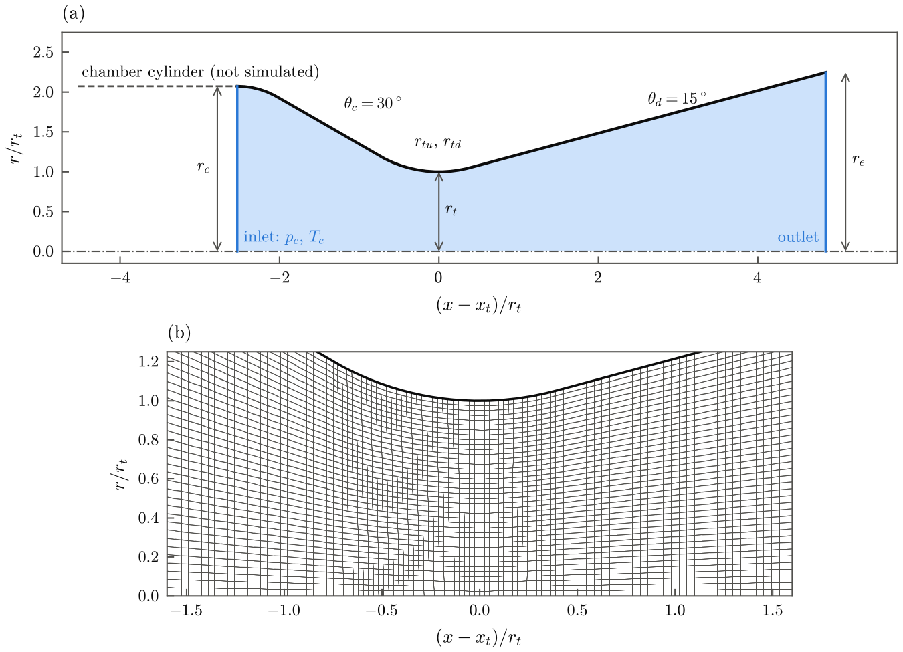

# The OpenFOAM case

`ceatofoam case` writes a complete case for `rhoCentralFoam` of OpenFOAM
(openfoam.com, tested with v2606):

```text
cases/rp1/
├── 0.orig/                 p, T, U (and k, omega, nut, alphat for k-ω SST)
├── constant/
│   ├── thermophysicalProperties   frozen mixture: janaf + sutherland fits
│   └── turbulenceProperties
├── system/
│   ├── blockMeshDict       5° wedge of the contour
│   ├── controlDict         local time stepping, function objects
│   ├── fvSchemes, fvSolution
│   ├── topoSetDict, setFieldsDict   1-D frozen initial field
│   └── decomposeParDict
├── Allrun, Allclean
└── ceatofoam.json          record: input, CEA, mixture, fits, design, contour, mesh, versions
```

`./Allrun` restores `0/` from `0.orig/` and runs `blockMesh`, `checkMesh`,
`topoSet`, `setFields` and `rhoCentralFoam`, decomposing the case first when
`solver.n_procs` is larger than 1.

## Domain and mesh

<figure markdown>
{ .figure }
<figcaption>RP-1/LOX thrust chamber at 500 psia, sized with the frozen
mixture: (a) contour and computational domain (shaded), from the end of the
chamber cylinder to the exit plane; (b) mesh near the throat on the front
plane of the wedge.</figcaption>
</figure>

The domain is a 5° wedge about the axis, from the end of the cylindrical
chamber to the exit plane. In a steady frozen flow the cylinder is a duct at
constant total conditions; its low Mach number slows the convergence of the
density-based solver and produces spurious oscillations near the axis, so the
chamber stagnation state is imposed at the end of the cylinder instead.
`mesh.include_cylinder: true` meshes the cylinder anyway.

The exit plane is supersonic, so thrust and mass flow need no plume region.
For pictures of the jet, `mesh.plume_length` adds a region behind the exit,
`plume_length` exit diameters long and `plume_radius` exit radii wide, with
the cells growing from the exit-plane size.

Every axial station has `radial_cells` cells between the axis and the wall,
and the axial size of a cell is `cell_aspect` times its radial size. The
resolution therefore follows the local radius, the throat is always resolved,
and the same settings give the same relative resolution at any engine size.
The default mesh of the example has 8720 cells.

## Patches and boundary conditions

| Patch | Where | p | T | U |
| --- | --- | --- | --- | --- |
| `inlet` | end of the chamber cylinder | `totalPressure` \(p_c\) | `totalTemperature` \(T_c\) | `zeroGradient` |
| `nozzle` | wall | `zeroGradient` | `zeroGradient` (adiabatic) | `noSlip` (`slip` for inviscid) |
| `outlet` | exit plane | `zeroGradient` | `inletOutlet` | `inletOutlet` |
| `front`, `back` | wedge faces | `wedge` | `wedge` | `wedge` |
| `base` | engine base, with a plume | as `nozzle` | as `nozzle` | as `nozzle` |
| `farfield` | outer boundary, with a plume | `totalPressure` \(p_a\) | `inletOutlet` \(T_a\) | `pressureInletOutletVelocity` |

With the k-ω SST model, \(k\) and \(\omega\) at the inlet follow from a
turbulence intensity of 5 % and a mixing length of 0.07 chamber diameters, and
the walls use wall functions. The ambient gas of a plume region is the
exhaust mixture at the ambient pressure and temperature.

## Thermophysical model

```text
thermoType
{
    type            hePsiThermo;
    mixture         pureMixture;
    transport       sutherland;
    thermo          janaf;
    equationOfState perfectGas;
    specie          specie;
    energy          sensibleInternalEnergy;
}
```

The gas is one pseudo-species, the frozen chamber mixture. Its janaf
coefficients (200 to 1000 K and 1000 to 6000 K, with \(c_p\) and its
derivative continuous at 1000 K) and Sutherland constants are fitted to the
Cantera evaluation of the same mixture that sized the nozzle; the fit errors
are recorded in `ceatofoam.json`. When the expansion of a cold-flow case falls
below 400 K, the lower limit of the fit is lowered to half of the coldest
expected temperature. See [Method](method.md#flow-solver-and-simulation-setup).

## Numerics

`rhoCentralFoam` with the Kurganov–Tadmor central-upwind flux and van Leer
reconstruction of \(\rho\), \(U\) and \(T\). The steady state is reached by
local time stepping at a Courant number of 0.2 (`solver.max_co`), starting from
the one-dimensional frozen solution, which `setFields` writes into axial
slices of the chamber. The default 20 000 iterations take about 5 min
(inviscid) to 8 min (k-ω SST) on one core for 8720 cells.

## Function objects

| Name | Records |
| --- | --- |
| `inletFlux`, `throatFlux`, `exitFlux` | mass flow rate through the inlet, the throat plane and the exit plane |
| `inletPressure`, `inletMomentum` | pressure and momentum flux at the inlet |
| `exitPressure`, `exitMomentum`, `exitAverage` | exit-plane pressure and momentum integrals, area averages of p, T and Mach number |
| `wallForce` | axial force of the gas on the wall |
| `minMax` | extremes of p and T |
| `MachNo` | Mach number field |
| `profiles` | axis and wall profiles |

`ceatofoam post` averages these over the last quarter of the iterations and
evaluates the thrust from the exit plane and, as a check of the momentum
budget, from the inlet fluxes and the wall force (see [Usage](usage.md#4-evaluating-it)).
A solution is accepted when the inlet and exit mass flow rates agree within
0.5 %.
