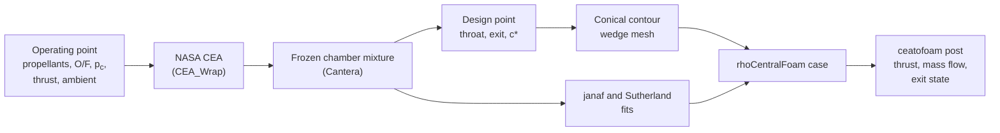

# ceaToFoam

**From a NASA CEA chamber solution to a ready-to-run OpenFOAM thrust-chamber case.**

<figure markdown>
{ .figure }
<figcaption>Mach number (upper half) and temperature (lower half) in an RP-1/LOX
thrust chamber at 500 psia and O/F 2.4, sized for 2250 lbf at sea level with
the frozen mixture and computed with the k-ω SST model.</figcaption>
</figure>

ceaToFoam takes the propellants, chamber pressure, mixture ratio and design
thrust of a liquid-rocket engine and writes an axisymmetric `rhoCentralFoam`
case for the flow through its conical thrust chamber. The chamber composition
computed by CEA is frozen and evaluated with one set of thermodynamic and
transport data, and this one description of the gas both sizes the nozzle and
defines the thermophysical model of the simulation. The design point and the
CFD therefore describe the same gas, and the difference between them is the
multidimensional and viscous loss of the thrust chamber rather than an
artefact of the handoff.

## What it does



1. CEA is run for the propellants, chamber pressure and mixture ratio, with
   shifting equilibrium and frozen at the chamber.
2. The chamber composition is frozen and evaluated with
   [Cantera](https://cantera.org): molecular weight, \(c_p(T)\), \(h\), \(s\)
   and viscosity.
3. The throat and exit are sized for the design thrust at matched expansion,
   by default along the isentrope of the frozen mixture.
4. A conical contour is built (cylinder, fillet, convergent cone, throat arcs,
   divergent cone) with the chamber volume given by \(L^*\).
5. A 5° wedge `blockMeshDict` and a `rhoCentralFoam` case are written, with
   `janaf` and `sutherland` coefficients fitted to the same frozen mixture.
6. After the run, `ceatofoam post` evaluates the thrust, the mass flow rate
   and the exit state against the design point.

## Results in brief

The procedure has been verified by a grid convergence study and validated
against wall-pressure and discharge-coefficient measurements in conical
nozzles (see [Verification and validation](validation.md)):

| Check | Result |
| --- | --- |
| Frozen sizing reproduces CEA's frozen solution | exit temperature, Mach number and \(I_{sp}\) within 0.1 % |
| Simulated exit pressure vs. design, frozen sizing, inviscid | within 2.03 % (RP-1, CH₄, H₂ with LOX; 500 and 1500 psia) |
| Simulated mass flow rate vs. design, frozen sizing, inviscid | within 0.542 % |
| Wall pressure, Back et al. (1965) | RMS deviation of \(p/p_t\) at most 0.018 |
| Discharge coefficient, Back and Cuffel (1971) | within the measurement uncertainty for 5 of 7 nozzles |
| Base mesh vs. finest mesh | thrust, mass flow, \(p_e\), \(I_{sp}\) within 0.27 % |

Sizing the same nozzles with the equilibrium isentropic exponent
\(\gamma_s\) instead gives exit pressures 16 to 21 % below the design value in
the frozen-flow simulation, while the mass flow rate stays within 0.7 % of
it. The [Method](method.md) page explains why.

## Quick start

```sh
git clone https://github.com/MCF2-Lab/ceaToFoam.git && cd ceaToFoam
pip install .

ceatofoam design examples/rp1-lox-500psi.yaml             # design point
ceatofoam case   examples/rp1-lox-500psi.yaml cases/rp1   # write the case
cd cases/rp1 && ./Allrun                                  # run OpenFOAM
ceatofoam post   .                                        # -> results.json
```

The CEA executable has to be compiled once on Linux and macOS; see
[Installation](installation.md).

## Scope

ceaToFoam is meant for preliminary thrust-chamber design studies, for
separating the losses of a conical nozzle from its thermochemistry, and for
teaching. The composition is frozen at the chamber (no finite-rate or
shifting chemistry in the nozzle), the gas is ideal, the walls are adiabatic
and the contour is conical. Injectors, combustion and wall cooling are not
modelled.
