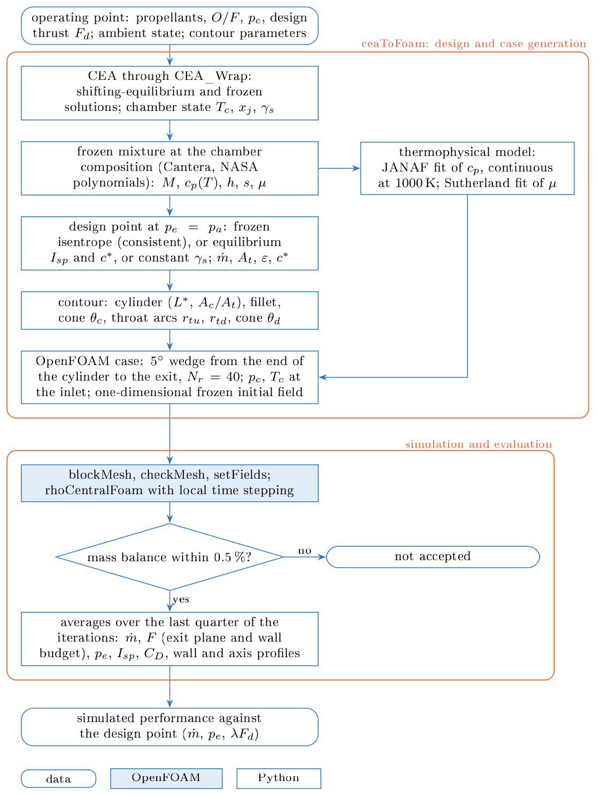

# Method

The chamber state computed by CEA is converted into one frozen mixture. This
mixture defines both the design point that sizes the thrust chamber and the
thermophysical model of the simulation. The contour, the mesh and the case are
generated from the design point, and the simulated performance is evaluated
against it.

<figure markdown>
{ .figure width="560" }
<figcaption>Workflow. The steps in the upper frame are carried out by
ceaToFoam; the case it writes is run by OpenFOAM (shaded) and evaluated by
<code>ceatofoam post</code>.</figcaption>
</figure>

## Chamber thermochemistry and the frozen mixture

The chamber state is computed with NASA CEA (Gordon and McBride, 1994;
McBride and Gordon, 1996), called through CEA_Wrap, for the propellants, the
mixture ratio O/F, the chamber pressure \(p_c\) and the ratio of chamber to
ambient pressure. Each operating point is solved twice, with shifting
equilibrium and with the composition frozen at the chamber. Both solutions
share the chamber state: the adiabatic flame temperature \(T_c\), the mole
fractions \(x_j\) of the products and the equilibrium isentropic exponent
\(\gamma_s\).

The chamber composition is then frozen and evaluated with the ideal-gas
polynomials of McBride et al. (1993) as distributed with Cantera (the
high-temperature GRI-Mech 3.0 data set, 200 to 6000 K). The molecular weight
and gas constant of the mixture are

\[
M = \sum_{j=1}^{N_s} x_j M_j, \qquad R = \frac{R_u}{M},
\]

and \(c_p(T)\), \(h(T)\) and \(s(T, p)\) follow from the species polynomials at
the fixed composition. The frozen ratio of specific heats is

\[
\gamma_f(T) = \frac{c_p(T)}{c_p(T) - R}.
\]

\(\gamma_f\) differs from the equilibrium exponent \(\gamma_s\) that CEA reports
for the chamber, because \(\gamma_s\) includes the shift of the composition
with pressure and temperature. For RP-1/LOX at 500 psia and O/F 2.4,
\(\gamma_s = 1.139\) and \(\gamma_f(T_c) = 1.217\). The viscosity is evaluated
with the mixture-averaged transport model of Cantera.

## Design point and sizing models

The thrust chamber is sized for a design thrust \(F_d\) at matched expansion,
\(p_e = p_a\).

### Frozen (default)

The flow expands isentropically from the chamber state with the composition
and thermodynamic functions above. At a pressure \(p\) the temperature follows
from \(s(T, p) = s(T_c, p_c)\), and

\[
u = \sqrt{2\left[h(T_c) - h(T)\right]}, \qquad
\rho = \frac{p}{R T}, \qquad
a = \sqrt{\gamma_f(T)\, R T}.
\]

The throat is the station where \(u = a\) and the exit the station where
\(p = p_a\). Then

\[
\dot m = \frac{F_d}{u_e}, \qquad
A_t = \frac{\dot m}{(\rho u)_t}, \qquad
\varepsilon = \frac{(\rho u)_t}{(\rho u)_e}, \qquad
c^* = \frac{p_c}{(\rho u)_t}.
\]

This model is consistent with the simulation: it reproduces CEA's own frozen
solution (exit temperature, Mach number and \(I_{sp}\) within 0.1 %), and the
simulated nozzle reaches the design exit pressure.

### Equilibrium

\(u_e = g_0 I_{sp}\) and \(A_t = \dot m c^*/p_c\), with \(I_{sp}\), \(c^*\) and the
expansion ratio of the shifting-equilibrium CEA solution at \(p_c/p_a\).

### Constant gamma

The relations of a calorically perfect gas,

\[
u_e = \sqrt{\frac{2\gamma R T_c}{\gamma - 1}\left[1 - \left(\frac{p_a}{p_c}\right)^{(\gamma-1)/\gamma}\right]}, \qquad
A_t = \frac{\dot m \sqrt{R T_c}}{p_c\, \Gamma(\gamma)}, \qquad
\Gamma(\gamma) = \sqrt{\gamma}\left(\frac{2}{\gamma+1}\right)^{\frac{\gamma+1}{2(\gamma-1)}},
\]

with the expansion ratio from the area–Mach number relation at the exit Mach
number. \(\gamma\) and \(M\) are set by `design.gamma` and
`design.molecular_weight` ([Input reference](input.md#design)).

!!! warning "Consistent sizing"
    The equilibrium and constant-\(\gamma_s\) models describe a gas whose
    composition shifts during the expansion, while the simulation transports a
    frozen gas. The nozzles they give are too large for that gas and run
    over-expanded, by 10 to 23 % in exit pressure for the cases of
    [Verification and validation](validation.md#thermochemical-handoff). Their
    mass flow rate stays close to the design value, so the mass flow alone
    does not reveal the inconsistency.

## Thrust chamber geometry

The contour consists of a cylindrical chamber of radius \(r_c\), a fillet arc
tangent to the cylinder and to a convergent cone of half-angle \(\theta_c\), a
circular-arc throat with radii of curvature \(r_{tu}\) upstream and \(r_{td}\)
downstream, and a divergent cone of half-angle \(\theta_d\) that ends at the
exit radius \(r_e = r_t\sqrt{\varepsilon}\). Every arc is tangent to its
neighbours. The chamber radius follows from the contraction ratio

\[
\frac{A_c}{A_t} = 8.0\, D_t^{-0.6} + 1.25
\]

with \(D_t\) in centimetres (Humble et al., 1995, Fig. 5.24), and the cylinder
length makes the volume between the injector face and the throat equal to
\(L^* A_t\) (Huzel and Huang, 1992). The defaults are \(\theta_c = 30°\),
\(\theta_d = 15°\), \(r_{tu} = r_{td} = 1.5\,r_t\), a fillet radius of \(r_t\)
and \(L^* = 40\) in (1.016 m).

## Flow solver and simulation setup

The flow is computed with `rhoCentralFoam` (Greenshields et al., 2010), which discretises the
compressible Navier–Stokes equations with the central-upwind fluxes of
Kurganov and Tadmor (2000); density, velocity and temperature are
reconstructed at the faces with the van Leer limiter. The gas is the frozen
mixture, a perfect gas with the molecular weight \(M\).

Its specific heat is represented by two quartic polynomials of temperature
(the janaf form of OpenFOAM) on 200 to 1000 K and 1000 to 6000 K, fitted by
least squares to \(c_p(T)\) with \(c_p\) and its derivative continuous at
1000 K. The enthalpy and entropy constants of the lower range reproduce the
mixture values at 298.15 K and 1 bar, and those of the upper range make \(h\)
and \(s\) continuous at 1000 K. The viscosity follows Sutherland's law, with
its two constants fitted to the mixture viscosity between 0.8 times the design
exit temperature and 1.05 \(T_c\).

Three flow models are available: inviscid flow (zero viscosity, slip walls),
laminar flow, and the k-ω SST model with wall functions. The walls are
adiabatic. The chamber stagnation pressure and temperature are imposed at the
end of the cylinder, and all quantities are extrapolated at the supersonic
exit plane. The steady state is reached by local time stepping at a Courant
number of 0.2 from the one-dimensional frozen solution.

## Evaluation of the performance

The mass flow rate and the thrust are integrated over the exit plane,

\[
\dot m = \int_{A_e} \rho\, \mathbf{u}\cdot\mathbf{n}\, \mathrm{d}A, \qquad
F = \int_{A_e} \left[\rho\, u_x\, \mathbf{u}\cdot\mathbf{n} + (p - p_a)\, n_x\right] \mathrm{d}A,
\]

and the same thrust follows from the momentum and pressure fluxes at the inlet
and the axial force on the wall; the difference between the two measures the
closure of the momentum budget. The specific impulse is
\(I_{sp} = F/(\dot m g_0)\) and the discharge coefficient
\(C_D = \dot m/\dot m_{1D}\), where \(\dot m_{1D}\) is the one-dimensional frozen
mass flow through the throat area of the contour.

A conical nozzle loses thrust through the radial velocity at its exit. For an
inviscid conical flow the divergence efficiency is (Humble et al., 1995,
Eq. 5.40)

\[
\lambda = \frac{1 + \cos\theta_d}{2},
\]

0.983 for \(\theta_d = 15°\). The simulated thrust is therefore compared with
\(\lambda F_d\); the remaining deviation contains the transonic, viscous and
thermochemical effects that the one-dimensional design point does not
represent.

## Limitations

The composition is frozen at the chamber, so there is no finite-rate or
shifting chemistry in the nozzle; the gas is ideal; the walls are adiabatic;
the contour is conical; and the ambient gas of a plume region is the exhaust
mixture at ambient conditions. The mesh is the same for all flow models and is
not adapted to the near-wall resolution of the k-ω SST model, so viscous
losses computed with it depend on the wall functions and are estimates.

## References

- Gordon, S., McBride, B. J. (1994). *Computer Program for Calculation of
  Complex Chemical Equilibrium Compositions and Applications. I. Analysis.*
  NASA RP-1311.
- McBride, B. J., Gordon, S. (1996). *Computer Program for Calculation of
  Complex Chemical Equilibrium Compositions and Applications. II. Users
  Manual and Program Description.* NASA RP-1311.
- McBride, B. J., Gordon, S., Reno, M. A. (1993). *Coefficients for
  Calculating Thermodynamic and Transport Properties of Individual Species.*
  NASA TM-4513.
- Humble, R. W., Henry, G. N., Larson, W. J. (1995). *Space Propulsion
  Analysis and Design.* McGraw-Hill, New York.
- Huzel, D. K., Huang, D. H. (1992). *Modern Engineering for Design of
  Liquid-Propellant Rocket Engines.* Progress in Astronautics and
  Aeronautics 147, AIAA. [doi:10.2514/4.866197](https://doi.org/10.2514/4.866197)
- Kurganov, A., Tadmor, E. (2000). New high-resolution central schemes for
  nonlinear conservation laws and convection–diffusion equations. *Journal of
  Computational Physics* 160, 241–282.
  [doi:10.1006/jcph.2000.6459](https://doi.org/10.1006/jcph.2000.6459)
- Greenshields, C. J., Weller, H. G., Gasparini, L., Reese, J. M. (2010).
  Implementation of semi-discrete, non-staggered central schemes in a
  colocated, polyhedral, finite volume framework, for high-speed viscous
  flows. *International Journal for Numerical Methods in Fluids* 63, 1–21.
  [doi:10.1002/fld.2069](https://doi.org/10.1002/fld.2069)
