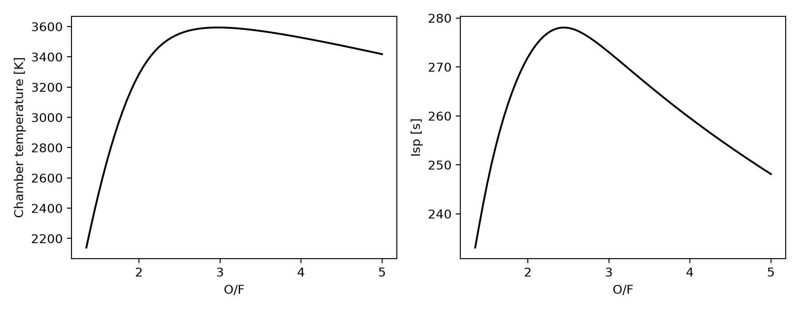

# Usage

ceaToFoam is used through the `ceatofoam` command:

| Command | What it does |
| --- | --- |
| `ceatofoam design INPUT` | Print the CEA results, the frozen mixture and the design point |
| `ceatofoam case INPUT CASE_DIR` | Write the OpenFOAM case and its record `ceatofoam.json` |
| `ceatofoam post CASE_DIR [--window 0.25]` | Average the last part of the run and write `results.json` |
| `ceatofoam sweep --fuel F --oxidizer O --pressure P` | Run CEA over a range of O/F |
| `ceatofoam interactive CASE_DIR` | Ask for the inputs on the console, then write the case |

`INPUT` is a YAML file; see [Input reference](input.md).

## Walkthrough: an RP-1/LOX thrust chamber

The example [`examples/rp1-lox-500psi.yaml`](https://github.com/MCF2-Lab/ceaToFoam/blob/main/examples/rp1-lox-500psi.yaml)
describes a 500 lbf RP-1/LOX engine at 500 psi and O/F 2.4, at sea level:

```yaml
propellants:
  fuel: RP-1
  oxidizer: O2(L)
chamber:
  pressure: 500 psi
  mixture_ratio: 2.4
design:
  thrust: 500 lbf
  altitude: 0 ft
  sizing: frozen
geometry:
  characteristic_length: 40 in
  convergent_half_angle: 30 deg
  divergent_half_angle: 15 deg
mesh:
  radial_cells: 40
solver:
  model: kOmegaSST
  iterations: 20000
```

### 1. The design point

```console
$ ceatofoam design examples/rp1-lox-500psi.yaml
Chamber: pc = 34.47 bar, Tc = 3526.5 K
Ambient: p = 101400.9 Pa, T = 288.19 K
CEA equilibrium: Isp =  278.00 s, c* =  1792.5 m/s, gamma_s(c) = 1.1389, M(c) = 22.549
CEA frozen     : Isp =  265.02 s, c* =  1748.5 m/s, gamma_s(c) = 1.2173, M(c) = 22.549
Frozen mixture: M = 22.5487 kg/kmol, gamma(Tc) = 1.2173, dropped species {'COOH': 1e-05}
Design (frozen):
  thrust       2224.11
  pc           3.44738e+06
  tc           3526.5
  p_amb        101401
  pe           101401
  te           1831
  mach_e       2.83779
  ve           2600.04
  mdot         0.855414
  cstar        1748.52
  area_ratio   5.04889
  at           0.000433869
  ae           0.00219056
  gamma_c      1.2173
  gamma_e      1.24337
  mw           22.5487
  rt           0.0117518
  re           0.026406
  isp          265.13
Contour:
  cylinder length 0.148708 m, throat at x = 0.186253 m, exit at x = 0.243264 m
  contraction ratio 6.041, area ratio 5.049
```

The design point is in SI units. The frozen sizing reproduces CEA's own frozen
solution: \(I_{sp}\) = 265.13 s against 265.02 s, \(c^*\) = 1748.5 m/s in
both. Species that the thermodynamic data set does not contain are dropped
and reported (here 10 ppm of COOH).

### 2. The case

```console
$ ceatofoam case examples/rp1-lox-500psi.yaml cases/rp1
Wrote cases/rp1: 8720 cells, design thrust 2224.11 N, mdot 0.855414 kg/s. Run ./Allrun in the case.
```

The case is described on [The OpenFOAM case](case.md). Its file
`ceatofoam.json` records the input, the CEA results, the frozen mixture, the
fit errors, the design point, the contour, the mesh and the versions of every
component, including the source revision of ceaToFoam, so that a case can
always be traced back to how it was made.

### 3. Running it

```sh
cd cases/rp1
./Allrun        # blockMesh, checkMesh, topoSet, setFields, rhoCentralFoam
```

With the default 20 000 iterations, one core takes about 5 min (inviscid) to
8 min (k-ω SST) for the 8720 cells of this case. Set `solver.n_procs` to run
in parallel.

### 4. Evaluating it

```sh
ceatofoam post .
```

`post` averages the function-object output over the last quarter of the
iterations (`--window`) and writes `results.json`. For the k-ω SST run of the
same engine at 2250 lbf it contains, among others:

```json
{
  "mdot_exit": 3.8203,
  "mdot_balance": -0.00036,
  "thrust_exit": 9741.4,
  "thrust_wall_budget": 9737.8,
  "momentum_closure": -0.00037,
  "isp": 260.02,
  "pe_mean": 105142.5,
  "te_mean": 1863.2,
  "mach_e_mean": 2.779,
  "iterative_std_mdot": 0.0020,
  "iterative_std_thrust": 0.0028,
  "discharge_coefficient": 0.9921,
  "design": {"model": "frozen", "thrust": 10008.5, "mdot": 3.8494, "pe": 101400.9, "...": "..."},
  "thrust_error": -0.0267,
  "mdot_error": -0.0076,
  "pe_error": 0.0369
}
```

| Key | Meaning |
| --- | --- |
| `mdot_inlet`, `mdot_throat`, `mdot_exit` | mass flow rate through the inlet, the throat plane and the exit plane [kg/s] |
| `mdot_balance` | relative difference of the exit and inlet mass flow rates; judge convergence by it (accept within 0.5 %) |
| `thrust_exit` | thrust from the exit-plane momentum and pressure integrals [N] |
| `thrust_wall_budget` | the same thrust from the inlet fluxes and the wall force; `momentum_closure` is the relative difference |
| `pe_mean`, `te_mean`, `mach_e_mean` | area-averaged exit pressure, temperature and Mach number |
| `iterative_std_*` | relative standard deviation over the averaging window |
| `discharge_coefficient` | \(\dot m / \dot m_{1D}\), the one-dimensional frozen mass flow through the throat area of the contour |
| `t_min_window`, `t_max_window`, `janaf_t_low` | temperature extremes of the window and the lower limit of the janaf fit |
| `design` | the design point the case was sized for |
| `thrust_error`, `mdot_error`, `pe_error` | relative deviation of the simulation from the design point |

The thrust deficit of −2.7 % in this example is the divergence loss of the
15° cone (1.7 %), the two-dimensional transonic flow (0.3 %) and the
turbulent boundary layer (0.7 %); see
[Verification and validation](validation.md).

## Mixture-ratio sweep

`sweep` runs CEA alone over a range of mixture ratios, which helps to choose
the operating point:

```console
$ ceatofoam sweep --fuel RP-1 --oxidizer "O2(L)" --pressure "500 psi" --plot of.png
O/F      Tc [K]     Isp [s]
 1.35     2139.6     233.10
 ...
Peak chamber temperature 3593.4 K at O/F = 2.95
Peak Isp 278.05 s at O/F = 2.45
```

{ .figure }

Options: `--of-min`, `--of-max`, `--of-step` (default 1.0 to 5.0 in steps of
0.05), `--altitude` (default sea level) and `--analysis equilibrium|frozen`.

## Interactive input

`ceatofoam interactive CASE_DIR` asks for the propellants, the chamber
pressure, the mixture ratio, the thrust, the altitude, the sizing model and
the main geometry parameters on the console, with defaults, and writes the
case. It is a shortcut for a first
case; for repeatable work, keep the input in a YAML file.
