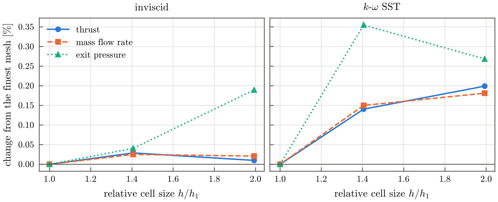
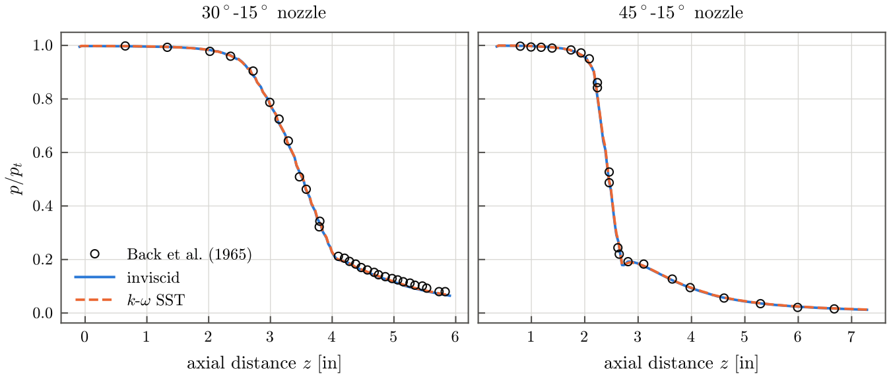
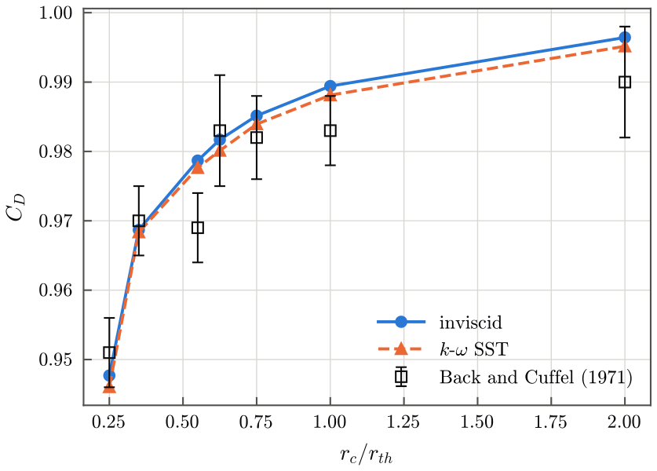
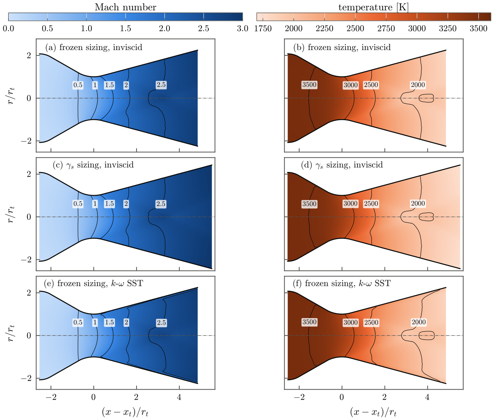
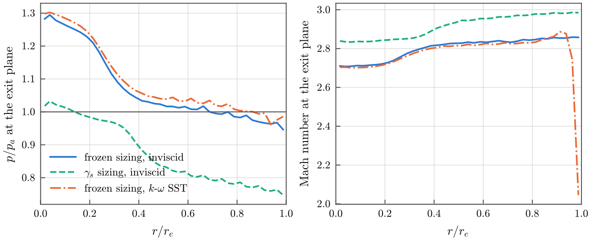
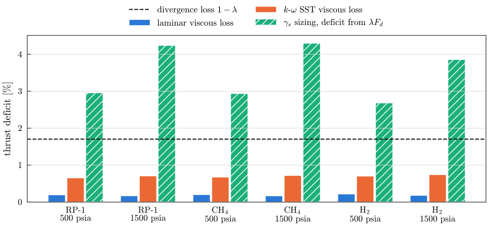

# Verification and validation

The procedure has been tested on 56 simulations: a grid convergence study,
two validation cases against measurements in conical nozzles, and design
cases that compare three sizing models for three propellant combinations at
two chamber pressures. All were run with ceaToFoam 2.0 and OpenFOAM v2606,
and every simulation satisfies the convergence criterion (inlet and exit mass
flow rates within 0.5 %).

| Case | Gas | Conditions | Variants | Runs |
| --- | --- | --- | --- | --- |
| V1 | air | \(p_t\) = 150.6, 250.2 psia; \(T_t\) = 833 K | 30°–15° and 45°–15° nozzles; inviscid, SST | 4 |
| V2 | air | \(p_t\) = 100 psia; \(T_t\) = 294 K | \(r_c/r_{th}\) = 0.25–2.0; inviscid, SST | 14 |
| G1 | RP-1/LOX | O/F 2.4; \(p_c\) = 500 psia | three meshes; inviscid, SST | 6 |
| H1 | RP-1, CH₄, H₂ / LOX | O/F 2.4, 3.6, 6.0; \(p_c\) = 500, 1500 psia | frozen, equilibrium, \(\gamma_s\) sizing; inviscid | 18 |
| H2 | as H1 | as H1 | frozen sizing; laminar, SST | 12 |
| D1 | RP-1/LOX | \(p_c\) = 1410, 982 psia; O/F 2.36, 2.27 | Merlin-1D-like, F-1-like; frozen sizing; SST | 2 |

The design cases use the default geometry, a design thrust of 2250 lbf
(10.01 kN) unless stated, and sea-level ambient conditions.

## Grid convergence

The mesh study G1 multiplies every cell count of the base mesh by 1, √2 and
2. Over all three meshes, the thrust, mass flow rate, exit pressure and
specific impulse change by at most 0.149 % (inviscid) and 0.355 % (k-ω SST),
and the base mesh, which is the coarsest, differs from the finest by at most
0.27 %. That is about two orders of magnitude below the handoff effects
discussed below.

{ .figure }

| Model | Quantity | Extrapolated | GCI | GCI (\(p = 2\), \(F_s = 3\)) |
| --- | --- | --- | --- | --- |
| inviscid | thrust [N] | 9799 | 0.068 % | 0.089 % |
| | mass flow [kg/s] | 3.828 | 0.006 % | 0.077 % |
| | exit pressure [Pa] | 1.028 × 10⁵ | 0.020 % | 0.125 % |
| | \(I_{sp}\) [s] | 261.2 | 0.002 % | 0.012 % |
| SST | thrust [N] | 9713 | 0.117 % | 0.432 % |
| | mass flow [kg/s] | 3.812 | 0.046 % | 0.462 % |
| | exit pressure [Pa] | 1.047 × 10⁵ | 0.137 % | 1.09 % |
| | \(I_{sp}\) [s] | 260.0 | 0.007 % | 0.029 % |

The grid convergence index follows Celik et al. (2008). Because the
differences between meshes are of the order of the iterative uncertainty and
change sign for some quantities, the last column also gives the more
conservative index of Roache (1994), with the formal order 2 and a factor of
safety of 3.

## Validation: wall pressure in conical nozzles

Case V1 reproduces the wall-pressure measurements of Back, Massier and Gier
(1965) in two conical nozzles with a 15° divergent cone: a 30° convergent
section with a throat radius of curvature of 2.0 throat radii, and a 45°
convergent section with 0.625 throat radii. The nozzles are given by their
published dimensions ([explicit geometry](input.md#explicit-geometry)), and
the generated contours reproduce the published tangency stations of the
throat arcs to 0.001 in.

{ .figure }

The root-mean-square deviation of \(p/p_t\) from the measurements is 0.011
(30°–15°) and 0.018 (45°–15°), of the order of the combined uncertainty of
the digitised data (0.008) and the measurement (1 %). In the 45°–15° nozzle
the deviation is concentrated in the transonic region, where the small throat
radius of curvature gives the strongest two-dimensional effects; more than one
throat radius away from the throat it is 0.0025. The two flow models give
nearly the same wall pressures, since the boundary layers of these attached
flows are thin.

## Validation: discharge coefficient

Case V2 compares the computed discharge coefficients with the measurements
compiled by Back and Cuffel (1971) for air at throat Reynolds numbers above
10⁶, for throat radii of curvature from 0.25 to 2.0 throat radii.

<figure markdown>
{ .figure width="520" }
</figure>

| \(r_c/r_{th}\) | Convergent half-angle | Measured | Inviscid | SST |
| --- | --- | --- | --- | --- |
| 0.25 | 75° | 0.951 ± 0.005 | 0.9477 | 0.9460 |
| 0.35 | 30° | 0.970 ± 0.005 | 0.9687 | 0.9684 |
| 0.55 | 30° | 0.969 ± 0.005 | 0.9787 | 0.9776 |
| 0.625 | 45° | 0.983 ± 0.008 | 0.9817 | 0.9801 |
| 0.75 | 30° | 0.982 ± 0.006 | 0.9851 | 0.9839 |
| 1.0 | 30° | 0.983 ± 0.005 | 0.9894 | 0.9881 |
| 2.0 | 30° | 0.990 ± 0.008 | 0.9964 | 0.9952 |

The computed values lie within the measurement uncertainty for 5 of the 7
nozzles. Of the two exceptions, the measurement at 0.55 breaks the trend of
the others, and at 1.0 the SST value exceeds the measurement by 0.0051,
slightly more than its uncertainty of ±0.005. Contraction and expansion ratios
are not published for all of these nozzles and were taken from the 30°–15°
nozzle of case V1.

## Thermochemical handoff

The cases H1 size the same operating point with the three
[sizing models](method.md#design-point-and-sizing-models) and compare the
inviscid simulation of each nozzle with its own design point. The inviscid
model isolates the handoff from viscous losses.

{ .figure }

| Case | Frozen \(\Delta p_e\) | Frozen \(\Delta\dot m\) | Frozen \(\Delta F_\lambda\) | Equilibrium \(\Delta p_e\) | Equilibrium \(\Delta\dot m\) | \(\gamma_s\) \(\Delta p_e\) | \(\gamma_s\) \(\Delta\dot m\) | \(\gamma_s\) \(\Delta F_\lambda\) |
| --- | --- | --- | --- | --- | --- | --- | --- | --- |
| RP-1, 500 psia | +1.58 % | −0.54 % | −0.33 % | −15.4 % | +1.97 % | −18.0 % | +0.67 % | −2.96 % |
| RP-1, 1500 psia | +1.95 % | −0.52 % | −0.68 % | −13.7 % | +1.58 % | −21.4 % | +0.47 % | −4.24 % |
| CH₄, 500 psia | +1.58 % | −0.53 % | −0.33 % | −19.4 % | +1.89 % | −17.2 % | +0.20 % | −2.94 % |
| CH₄, 1500 psia | +2.01 % | −0.51 % | −0.71 % | −22.9 % | +1.57 % | −21.1 % | −0.26 % | −4.30 % |
| H₂, 500 psia | +1.58 % | −0.53 % | −0.33 % | −12.4 % | +1.50 % | −16.0 % | +0.41 % | −2.69 % |
| H₂, 1500 psia | +2.03 % | −0.51 % | −0.71 % | −10.5 % | +1.12 % | −19.6 % | +0.22 % | −3.86 % |

\(\Delta F_\lambda\) is the deviation of the thrust from \(\lambda F_d\), the design
thrust reduced by the divergence loss of the 15° cone.

With the frozen sizing, the simulated exit pressure is within 2.03 % of the
design value, the mass flow rate within 0.54 % (the discharge coefficient of
the throat, 0.994 to 0.995), and the thrust within 0.71 % of \(\lambda F_d\).
The design and the simulation describe the same gas, and the remaining
differences are two-dimensional effects in the transonic region and in the
conical divergent section.

With the sizing based on \(\gamma_s\), the exit pressure is 16 to 21 % below
the design value, and the deviation grows with the chamber pressure. The mass
flow rate is nonetheless within 0.7 % of the design value, because two errors
compensate at the throat: \(\Gamma(\gamma_f)/\Gamma(\gamma_s)\) makes the throat
1.6 to 2.4 % larger than the frozen gas requires, while the station-averaged
molecular weight lowers the mass flow through it by 0.9 to 1.7 %. The mass flow
rate is therefore a poor indicator of an inconsistent handoff. The
inconsistency appears in the expansion: the \(\gamma_s\) nozzles have expansion
ratios 15 to 21 % larger than the frozen ones.

<figure markdown>
{ .figure }
<figcaption>Mach number (left) and temperature (right) in the RP-1/LOX thrust
chamber at 500 psia, mirrored about the axis: (a, b) frozen sizing, inviscid;
(c, d) \(\gamma_s\) sizing, inviscid; (e, f) frozen sizing, k-ω SST.</figcaption>
</figure>

In units of the throat radius the frozen-sized and \(\gamma_s\)-sized flows are
almost identical up to the exit of the frozen-sized nozzle, where the gas
reaches the ambient pressure on average; the \(\gamma_s\) nozzle continues the
expansion and over-expands the gas. The temperature tells the same story: the
frozen design point predicts an exit temperature of 1831 K and the simulation
gives 1837 K, whereas the \(\gamma_s\) design point predicts 2294 K for a gas
that leaves its nozzle at 1761 K.

{ .figure }

The exit pressure is not uniform, since a nearly conical flow crosses a flat
exit plane: near the axis the gas has expanded less than near the wall. In the
frozen-sized nozzle the pressure is close to ambient over the outer half of the
radius, which carries most of the exit area; in the \(\gamma_s\)-sized nozzle it
is below ambient over most of the exit plane.

## Viscous losses

The cases H2 add the boundary layer to the frozen-sized nozzles. Relative to
the inviscid simulation of the same nozzle, the thrust changes by −0.17 to
−0.22 % with the laminar model and by −0.66 to −0.74 % with the k-ω SST model.

{ .figure }

Both viscous losses are smaller than the divergence loss of the 15° cone
(1.7 %) and much smaller than the thrust deficit of the \(\gamma_s\) sizing,
which would hide the viscous loss entirely. The mesh is not adapted to the
near-wall resolution of the SST model, so the SST losses depend on its wall
functions; the laminar and SST results bracket the viscous loss between fully
laminar and fully turbulent boundary layers.

## Large-engine operating points

The cases D1 apply the procedure at the operating points of two large kerosene
engines: an F-1-like case (1 522 000 lbf at sea level, 982 psia, O/F 2.27;
Betts, 2013) and a Merlin-1D-like case (190 000 lbf at sea level, SpaceX,
2020; the chamber pressure and mixture ratio are not published, and
representative values of 1410 psia and O/F 2.36 are used). The nozzles have throat radii of
0.417 m and 0.131 m and are meshed by the same rules, since the cell counts
scale with the throat radius. The simulated thrust deviates from \(\lambda F_d\)
by −1.1 % and −1.3 %, like the much smaller nozzles of the cases H2, and the
discharge coefficients are 0.992. These are demonstrations of the procedure at
large scale, not validation cases: the actual contours and operating histories
of these engines are not used.

## References

- Back, L. H., Massier, P. F., Gier, H. L. (1965). Comparison of measured and
  predicted flows through conical supersonic nozzles, with emphasis on the
  transonic region. *AIAA Journal* 3(9), 1606–1614.
  [doi:10.2514/3.3216](https://doi.org/10.2514/3.3216)
- Back, L. H., Cuffel, R. F. (1971). Flow coefficients for supersonic nozzles
  with comparatively small radius of curvature throats. *Journal of
  Spacecraft and Rockets* 8(2), 196–198.
  [doi:10.2514/3.30247](https://doi.org/10.2514/3.30247)
- Celik, I. B., Ghia, U., Roache, P. J., Freitas, C. J., Coleman, H., Raad,
  P. E. (2008). Procedure for estimation and reporting of uncertainty due to
  discretization in CFD applications. *Journal of Fluids Engineering* 130(7),
  078001. [doi:10.1115/1.2960953](https://doi.org/10.1115/1.2960953)
- Roache, P. J. (1994). Perspective: A method for uniform reporting of grid
  refinement studies. *Journal of Fluids Engineering* 116(3), 405–413.
  [doi:10.1115/1.2910291](https://doi.org/10.1115/1.2910291)
- Betts, E. M. (2013). Waking a giant: bringing the Saturn F-1 engine back to
  life. Presentation, NASA Marshall Space Flight Center, M13-3060 (NTRS
  20140011656).
- Space Exploration Technologies Corp. (2020). *Falcon User's Guide.*
